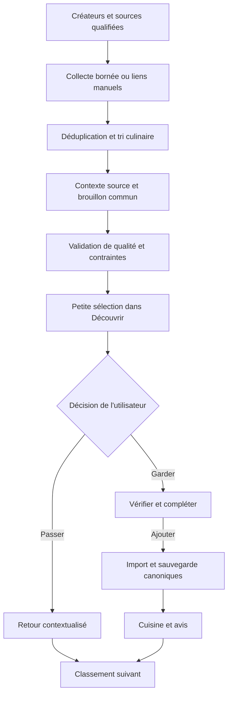

# PRP V10-03F — Découverte culinaire et veille de créateurs

> Statut : pilote gratuit F1/F2 implémenté et validé localement le 2026-10-12 ; F0 partiel et signaux F4 disponibles. Collecte F3, observation de 14 jours et homologation F5 non réalisées. [Rapport et migrations](../../docs/implementations/V10-03F.md).
> Priorité : P1 pour fiabilité des imports et expérience de découverte ; automatisation après preuve d'utilité.
> Produit : Smart Pantry Pro, responsive sur iPhone 17 Pro Max, puis client iOS.
> Besoin confirmé : alimenter régulièrement les recettes depuis des créateurs choisis ; donner envie de cuisiner ; décider quoi ajouter dans l'application.
> Créateurs du pilote : LouLouKitchen, `olivier_lin`, `andyhearnden` / Andy Cooks.
> Dépendances : références et écritures [V10-01](PRP-V10-01-Fiabilite.md), routine [V10-02](PRP-V10-02-Routine-Mobile.md), contraintes [V10-03](PRP-V10-03-Personnalisation.md), aperçus [V10-03A](PRP-V10-03A-Recettes-Apercus.md), design [V10-03B](PRP-V10-03B-Design-Culinaire.md).
> Réutilisation : politique de mémoire [V10-03C](PRP-V10-03C-Memoire-Fiable.md), configuration et reçus de coût [V10-03D](PRP-V10-03D-Agent-Modeles.md), médias [PRP-220.24](../PRP-220/220.24-Media-Storage-Rights-And-Pipeline.md) et vidéo [PRP-240](../PRP-240-Social-Video-Recipe-Import-V2.md), selon les chemins réellement montés.
> Référence de rédaction : checkout `e0bf8bf0`, avec modifications locales V10-03E préexistantes préservées. Le schéma distant, les comptes sociaux et l'application en production n'ont pas été contrôlés.
> Estimation proposée : 2 à 3 semaines pour fondations et pilote utilisable, puis 14 jours d'observation ; 1 à 2 semaines supplémentaires pour une première collecte automatique, hors accès et autorisations externes. À recalibrer en F0.

### Réalisation actuelle

Choix confirmé lors de l’implémentation : **« Pilote gratuit : liens et recettes écrites »**, plafond fournisseur 0 USD. Les imports canoniques, Découvrir, trois créateurs en mode manuel, marque-pages explicites, révisions/reprises et avis déclarés après cuisine sont réalisés. Deux migrations locales sont livrées ; aucune n’est appliquée au Supabase distant.

Le corpus réel contient 15 liens Andy, 5 LouLouKitchen et aucun lien de recette Olivier vérifié. Les sources écrites restent des références à ouvrir manuellement : leurs conditions ne qualifient pas la collecte automatisée. Aucun corps ou média source n’a été téléchargé. Les liens réels n’ont pas de photos source autorisées ; les captures UI utilisent des images fictives. Le classement initial privilégie diversité/date et garde les signaux explicites, sans mémoire implicite du couple. Les sorties globales ci-dessous restent ouvertes jusqu’aux preuves correspondantes.

## 1. Problème et résultat attendu

La bibliothèque contient déjà de nombreuses recettes, notamment indiennes et asiatiques. Certaines donnent moins envie à la femme de l'utilisateur lorsqu'elles sont présentées, alors qu'elle les apprécie après dégustation. L'utilisateur précise qu'elle aime les plats savoureux et cite trois créateurs comme sources d'inspiration.

Le lot doit renouveler la bibliothèque par une petite sélection régulière, appétissante et utilisable. La photo ou la publication d'origine aide à choisir ; les informations nécessaires pour cuisiner doivent être fidèles, vérifiables et corrigeables. « Savoureux » exprime une préférence : le système présente des caractéristiques documentées du plat, puis apprend de retours après cuisine. Il ne prétend pas garantir le goût.

Parcours directeur : **créateur suivi → nouvelle recette repérée → proposition dans Découvrir → garder ou passer → vérifier et ajouter → cuisiner → donner son avis**.

Résultat produit recherché : au moins une nouvelle recette issue de la découverte, réellement cuisinée et appréciée par semaine pendant le pilote. Le volume de publications collectées ne constitue pas un succès en soi.

## 2. Décisions et hypothèses

| Sujet | Statut | Conséquence |
| --- | --- | --- |
| LouLouKitchen, Olivier Lin et Andy Hearnden | Sources choisies par l'utilisateur | Liste de départ ; vérifier les identités et URL exactes en F0 |
| Plats savoureux, cuisines ouvertes | Préférence exprimée pour sa femme | Présentation concrète ; conserver de la diversité, y compris les cuisines déjà présentes |
| Ajouter ou refuser une proposition | Besoin confirmé | Aucune recette ajoutée à la bibliothèque par la seule collecte |
| Grandes photos, Cuisine personnelle | Direction V10-03B déjà choisie | Réutiliser ses composants et tokens ; aperçu avant ouverture de fiche |
| Suivre un créateur sur plusieurs sources | Choix proposé | Site de recettes, éditeur et réseaux associés à une même identité vérifiée |
| Collecte quotidienne ; sélection deux fois par semaine | Hypothèse de cadence | Réglable et suspendable ; 3 à 5 propositions par sélection, moins si nécessaire |
| Pilote d'environ 20 liens sur 14 jours | Hypothèse de validation | Corpus réparti entre les trois créateurs et plusieurs niveaux de complétude |
| Une spécialisation culinaire de l'agent | Choix d'architecture | Workflow borné ; acquisition, autorisations et écritures contrôlées par le serveur |
| Compte propriétaire en V1 | Limite du périmètre | Les goûts de sa femme rapportés dans ce chat ne sont pas écrits automatiquement dans la mémoire de l'application |

La rédaction autorise la préparation du lot. Elle n'active aucun cron, abonnement, appel payant, connexion à un compte social ou migration distante. Les budgets accordés pour V10-03D et V10-03E ne constituent pas un budget de ce nouveau lot.

## 3. Périmètre

### Inclus

- Fiabiliser le parcours actif de vérification et sauvegarde des imports avant sa réutilisation.
- Ajouter une surface Découvrir dans Cuisiner, avec sélection limitée, attribution et accès à la source.
- Gérer les trois créateurs du pilote, leurs sources vérifiées, leur pause et leur retrait.
- Accepter des liens ajoutés manuellement ; suivre ensuite les sources dont l'accès automatique a été validé.
- Réutiliser un seul contrat de brouillon et une seule persistance de recette pour web, agent et futur iOS.
- Distinguer inspiration, recette à compléter, recette vérifiée et recette ajoutée.
- Enregistrer envie, refus ponctuel, ajout, cuisine effective et avis après cuisine comme signaux distincts.
- Ajouter déduplication, reprise durable, coûts observables et arrêt de collecte.
- Publier preuves locales, résultats du pilote et conditions d'activation par connecteur.

### Hors V1

Recherche ouverte sur tous les réseaux, classement par popularité globale, messages aux créateurs, collecte de commentaires ou abonnements personnels, accès à des contenus privés, réutilisation de cookies de session, téléchargement universel de vidéos, génération d'images imitant une recette source, ajout autonome à la bibliothèque, planification ou consommation automatique du stock, nouveau système complet de comptes familiaux et notifications push obligatoires.

L'analyse audio/vidéo est une extension conditionnelle : seulement si les recettes écrites ou légendes accessibles sont insuffisantes, avec accès au média, droits, budget et worker éprouvés. F1/F2 doivent être utiles sans cette extension.

## 4. État du dépôt à revalider en F0

Les constats suivants portent sur le code local lu le 12 octobre, sans exécution du parcours connecté. Un service ou une migration présents dans le dépôt ne démontrent pas leur activité distante.

| Entrée réelle | Constat local | Action requise |
| --- | --- | --- |
| [app.ts](../../apps/api/src/app.ts), [imports.social.ts](../../apps/api/src/routes/imports.social.ts) | `/api/imports/social` et alias `/api/v1/imports/social` montés ; l'alias n'injecte pas `saveImportedDraftAsRecipe` comme le chemin principal | Aligner les dépendances et tester la sauvegarde sur les deux montages |
| [Recipes.tsx](../../src/pages/Recipes.tsx) | `onVerifyDraft` convertit le brouillon vers un payload ancien ; `handleExtractedConfirm` appelle `addRecipeWithIngredients` | Conserver `importId`, révision et provenance ; confirmer via le pipeline d'import canonique |
| [importsApi](../../src/services/recipe-import/api.ts), [SocialImportService](../../apps/api/src/services/imports/SocialImportService.ts), [saveImportedDraftAsRecipe](../../apps/api/src/services/imports/saveImportedDraftAsRecipe.ts) | Capture, extraction et sauvegarde existent ; un nouvel envoi d'un import déjà `saved` est rejeté par le service | Réconcilier le résultat après réponse perdue et préserver une seule recette |
| [ImportedRecipeDraft](../../packages/shared/src/recipe-import.ts) | Contrat partagé avec source, méthode, ingrédients, instructions, confiance et avertissements | Étendre seulement les informations manquantes ; aucun format culinaire parallèle |
| [WebAdapter](../../apps/api/src/services/imports/platforms/WebAdapter.ts) et [htmlParsers](../../apps/api/src/services/imports/platforms/htmlParsers.ts) | Lecture web protégée et parsing JSON-LD Recipe présents | Tester les pages retenues ; ne pas présumer qu'elles possèdent toutes un JSON-LD complet |
| [InstagramAdapter](../../apps/api/src/services/imports/platforms/InstagramAdapter.ts), [TikTokAdapter](../../apps/api/src/services/imports/platforms/TikTokAdapter.ts) | Métadonnées/oEmbed pour une URL connue ; aucun flux de veille de comptes | Distinguer rendu d'une publication et acquisition des nouvelles publications |
| [RecipeExtractionService](../../apps/api/src/services/imports/RecipeExtractionService.ts) | Baseline `gpt-4o-mini`, JSON validé ; méthodes metadata/oEmbed plafonnées à 0,6 | Le seuil `draft_ready >= 0.6` ne suffit pas à prouver une recette complète |
| [ImportCard](../../src/components/recipes/inbox/ImportCard.tsx) | Miniature 80 × 80 et états techniques de traitement | Une présentation culinaire dédiée doit reprendre les données, avec grands aperçus |
| [ThumbnailSnapshotService](../../apps/api/src/services/media/ThumbnailSnapshotService.ts) | Copie de miniature dans Storage avec `rightsStatus: platform_embed`, `rightsBasis: null` | Un libellé technique ne vaut pas autorisation de copie ; contrôler la politique avant réutilisation |
| [SocialVideoImportQueue](../../apps/api/src/services/imports/SocialVideoImportQueue.ts) | Service de file présent ; intégration et worker non établis sur les routes actives ; modèle annoncé pour un worker | Éviter de déclarer une chaîne vidéo opérationnelle ; éprouver toute intégration retenue |
| [videoParserService](../../apps/api/src/services/videoParserService.ts) | Chemin ancien avec dépendances dynamiques et valeurs de remplacement à examiner | Ne pas en faire le socle automatique sans inventaire et suppression des données inventées |
| [RecommendationEngine](../../apps/api/src/services/recommendations/RecommendationEngine.ts), [MemoryPolicy](../../apps/api/src/services/assistant/MemoryPolicy.ts) | Profil, contraintes, retours et mémoire filtrés par propriétaire ; « pas aujourd'hui » distinct d'un désamour | Réutiliser les calculs compatibles ; aucun profil de foyer supposé déjà opérationnel |
| [render.yaml](../../render.yaml) | Service web déclaré sur plan free ; aucune preuve de planification de cette veille | Planificateur indépendant du navigateur et des timers du serveur web |

Références SQL à examiner dans leur ordre d'application : [tables d'import](../../supabase/migrations/20260507000000_create_social_recipe_imports.sql), [RPC de sauvegarde](../../supabase/migrations/20260507120001_rpc_save_imported_recipe.sql), [évolution de cette RPC](../../supabase/migrations/20260516120000_save_imported_recipe_link_inventory.sql) et [jobs vidéo](../../supabase/migrations/20260523120001_social_video_import_jobs.sql). La dernière définition locale d'une fonction prévaut ; confirmer aussi la définition dans l'environnement de test.

## 5. Sources et stratégie d'acquisition

### 5.1 Créateurs du pilote

| Créateur | Source écrite établie par la recherche | Sources sociales à qualifier | Premier essai |
| --- | --- | --- | --- |
| Andy Hearnden / Andy Cooks | Site officiel avec fiches, photos, ingrédients et étapes : [exemple](https://www.andy-cooks.com/blogs/recipes/chicken-white-bean-stew) | `andyhearnden` fourni par l'utilisateur ; vérifier chaque compte et ses liens | Import d'une fiche écrite et association à la publication correspondante si elle est vérifiable |
| LouLouKitchen | Plusieurs recettes publiques chez [Marabout](https://www.marabout.com/auteur/loulou-kitchen/) | Profil exact à confirmer avant activation ; aucune URL TikTok déduite du nom Instagram | Tester une recette de l'éditeur et un lien social ajouté manuellement |
| Olivier Lin | Aucun site officiel de recettes confirmé lors de cette étude | `olivier_lin` fourni par l'utilisateur ; légendes et accès non testés | Échantillon manuel pour mesurer la complétude réelle et choisir la méthode |

La présence d'une fiche publique établit une piste d'extraction, pas une permission générale de republication ou de surveillance automatique. L'identité d'un créateur est vérifiée par ses liens officiels ; des noms ressemblants ne suffisent pas. Une recette d'éditeur ne correspond pas forcément à une publication récente.

### 5.2 Ordre de préférence

1. Recette écrite sur un site associé au créateur : JSON-LD Recipe lorsqu'il existe, puis contenu structuré explicitement accessible.
2. Légende complète obtenue par un accès qualifié ; conserver lien, date et provenance des données.
3. Métadonnées et embed d'une publication connue : suffisants pour une inspiration, insuffisants pour inventer une recette.
4. Transcription/OCR/vidéo seulement après décision d'extension. Documenter les champs encore indéterminés.
5. Lien manuel ou texte fourni par l'utilisateur si la source ne permet pas d'acquisition automatique.

Le site fournit la fidélité culinaire ; la publication associée peut fournir l'envie de cuisiner. En cas de contradiction, conserver les deux références et demander une vérification ; ne pas fusionner silencieusement des variantes.

### 5.3 Limites des plateformes

| Canal | Ce que les documents établissent | Condition d'activation |
| --- | --- | --- |
| Instagram oEmbed | Une intégration officielle Meta utilise désormais des endpoints sans jeton pour afficher une URL connue | Revoir l'adaptateur local Graph v19/token ; tester le rendu courant et les champs disponibles, sans supposer un flux de compte ou une miniature stable |
| Instagram Business Discovery | Piste officielle pour certains comptes professionnels, avec compte connecté et permissions adaptées | Vérifier couverture des trois créateurs, scopes, approbation et champs sur une réponse réelle ; possibilité non homologuée ici |
| TikTok Display API | Vidéos du créateur qui autorise l'application via OAuth | L'autorisation de Faizel ne donne pas accès au flux de tous les créateurs cités |
| TikTok embed/oEmbed | Affichage et métadonnées d'une URL connue | Ne pas traiter un embed comme une API d'énumération ou comme un accès au fichier vidéo |
| Connecteur commercial | Des outils de récupération de profils/publications sont des candidats | Qualification contractuelle, couverture, droits, tarifs et budget avant essai ; aucun appel fournisseur réalisé dans cette PRP |
| Site web du créateur ou de l'éditeur | Fiches accessibles ; JSON-LD/flux éventuel à examiner | Vérifier conditions d'accès, fréquence permise et rendu ; aucun RSS présumé disponible |

Pour chaque source, produire une fiche : mode d'accès, données récupérables, autorisation applicable, dates de vérification, limites, coût, fréquence maximale et état `manual_only | pending_verification | active | paused | access_error`. Seul un opérateur peut qualifier l'accès ; un texte récupéré ou un modèle ne peut pas déclarer une source autorisée.

La récupération technique et les droits sur textes, images ou vidéos sont deux décisions distinctes. En cas d'accès impossible, garder le mode manuel et les autres sources actives. Les conditions fournisseur et plateforme sont recontrôlées avant activation.

## 6. Expérience mobile

### 6.1 Entrée et présentation

Ajouter un onglet **Découvrir** dans Cuisiner, à côté de Bibliothèque et Importer. Conserver les quatre destinations de navigation V10. Aujourd'hui peut montrer une proposition et un lien vers la sélection ; l'ouverture de l'application ne déclenche pas un appel de collecte payant.

Chaque carte présente : grand aperçu autorisé, titre du plat, créateur, ingrédients principaux connus, durée indiquée par la source ou indisponible, et une courte raison factuelle de sélection. Les badges internes de confiance, fournisseur et file de traitement restent dans un détail secondaire.

Exemples de présentation à employer seulement si la source les confirme : « Poulet, haricots blancs et sauce tomate », « Patates douces rôties, crème de ricotta et herbes ». Une appréciation comme « tu vas adorer » ou un score de saveur calculé ne remplace pas un fait.

Actions visibles : **Garder**, **Passer**, **Voir la source**. Sans vidéo associée, « Voir la source » ouvre la fiche écrite. L'aperçu ne se transforme pas en vidéo jouée automatiquement.

### 6.2 Garder, vérifier et ajouter

1. **Garder** enregistre l'intention et ouvre le brouillon. La proposition reste retrouvable si la vérification est interrompue.
2. Le serveur rattache la proposition à un import canonique, sans perdre créateur, références, média et révision. Réutiliser un import déjà capturé pour cette source.
3. Afficher les informations confirmées, les quantités manquantes et les adaptations alimentaires avant l'action **Ajouter à mes recettes**.
4. Seule cette action confirme la persistance métier. Après succès, ouvrir la vraie référence de recette et proposer de cuisiner ou de garder pour plus tard.
5. Après réponse perdue, relire le résultat durable avant tout nouvel effet. Une édition échouée reste saisie et récupérable.

« Gardée », « à compléter » et « ajoutée à mes recettes » doivent rester trois états compréhensibles. Une inspiration sans ingrédients ni étapes peut être gardée comme lien ; elle ne devient pas une recette exploitable par une génération silencieuse.

### 6.3 États à couvrir

| Situation | Comportement attendu |
| --- | --- |
| Aucune nouveauté suffisante | Montrer la dernière sélection datée et l'accès aux sources ; aucun remplissage par recettes inventées |
| Une source en panne | Montrer les résultats des autres ; dernière récupération réussie et reprise disponible dans le détail |
| Image absente, expirée ou publication retirée | Carte utilisable avec titre, attribution et lien ; erreur d'image distinguée d'une recette supprimée |
| Brouillon incomplet | « À compléter » et liste concrète des champs inconnus |
| Quota d'import atteint | Intention conservée ; reprise après résolution, sans faux ajout ni contournement des quotas |
| Réseau interrompu | Conserver sélection déjà lue et saisie ; indiquer si l'action est envoyée, confirmée ou à réessayer |
| Changement de compte | Annuler les appels en cours et invalider caches/brouillons du précédent propriétaire |
| Retour depuis Instagram/TikTok | Retrouver sélection, position et vérification en cours |

Contrôles mobiles : actions d'au moins 44 px, texte lisible, focus visible, intitulés VoiceOver, contraste clair/sombre, zoom, titres longs, aucun débordement à 375 et 440 px. Tester aussi Safari sur l'iPhone réel ; un banc Chrome ne vaut pas cette preuve.

## 7. Qualité et provenance de recette

Réutiliser `ImportedRecipeDraft`. Ajouter un complément typé de qualité/provenance lorsqu'il est nécessaire, sans casser les brouillons historiques : état de complétude, références des sources, preuves de champs, inconnues, adaptations et révision. F0 fixe l'emplacement du complément après inventaire des contrats API/DB.

- Quantité ou portion inconnue : conserver l'absence ; aucun remplacement par `1`, `4` ou une quantité plausible.
- Temps total : utiliser une durée totale explicitement indiquée, ou documenter les composantes réellement connues ; ne pas confondre titre « 15 minutes » et préparation plus cuisson.
- Difficulté et matériel : reprendre une information explicite ou afficher une estimation qualifiée ; pas de certitude ajoutée par le modèle.
- Chaque ingrédient et étape essentiels possède une provenance exploitable : référence de fiche/légende, passage borné ou repère audio/vidéo si disponible. Une correction humaine est identifiée comme telle.
- Quantités, unités et traductions conservent le sens ; une conversion entre masse, volume et pièces exige une base explicite.
- Une recette « vérifiable » possède au minimum un titre culinaire, des ingrédients et des étapes cohérents ; les inconnues qui empêchent de cuisiner restent visibles jusqu'à résolution ou acceptation explicite dans un brouillon utilisable.
- Le seul `confidence` fourni par un modèle ou le statut technique `draft_ready` ne valide ni fidélité ni compatibilité.
- Réutiliser la politique PRP-239 : exclusions et adaptations obligatoires restent applicables ; montrer une substitution avant ajout, conserver la recette source et distinguer la version adaptée.
- Aucune disponibilité de stock, absence d'allergène ou adéquation santé n'est affirmée sans évaluation suffisante par les services métier. Une composition partielle conserve l'état à vérifier.

Pour classer des brouillons externes, extraire et réutiliser les fonctions pures compatibles du moteur V10-03 si nécessaire. Ne pas écrire provisoirement des recettes dans la bibliothèque et ne pas inventer une référence `recipes` pour une proposition non ajoutée. Après ajout, fiche, cuisine et recommandations utilisent la référence canonique existante.

## 8. Agent spécialisé et pipeline



Une seule orchestration serveur avec étapes explicites suffit en V1. Elle peut qualifier un contenu culinaire, extraire des faits et proposer un titre clair ; l'agent ne choisit pas librement ses sources, outils, propriétaires, téléchargements ou écritures.

Ordre de traitement : dédupliquer et exclure le contenu manifestement non culinaire avant une analyse coûteuse ; favoriser les fiches complètes ; vérifier les contraintes connues ; composer une sélection diversifiée ; produire des raisons fondées sur les faits disponibles.

Les collecteurs reçoivent uniquement les identifiants des sources. Ils n'ont accès ni au profil de santé, ni au stock, ni à l'historique ou à la mémoire privée. Le tri selon ces informations reste côté serveur. Si une synthèse personnalisée utilise un modèle, appliquer la politique V10-03C au contexte minimal nécessaire.

Les pages et légendes sont des données non fiables. Elles ne sont jamais injectées comme instructions privilégiées ; une phrase demandant d'appeler un outil ou de révéler des données est ignorée. Autorisations, URL permises, budget et validation sont imposés hors du modèle. La [documentation OpenAI sur la sécurité des agents](https://developers.openai.com/api/docs/guides/agent-builder-safety) décrit ce risque ; ce lot réutilise le backend existant et n'introduit pas Agent Builder.

Figer modèle, prompt et limites par invocation ; utiliser les rôles et reçus compatibles V10-03D. La baseline d'extraction locale reste le point de comparaison. Aucun changement de modèle par simple recherche de nouveauté. Employer des sorties structurées adaptées au transport et valider côté serveur : un [schéma respecté ne prouve pas la justesse des faits](https://developers.openai.com/api/docs/guides/structured-outputs).

## 9. Persistance, API et isolation

### 9.1 Modèle logique proposé

Les noms suivants sont proposés. F0 produit la matrice entre tables existantes, extensions et nouvelles tables ; les migrations sont créées seulement lors de l'implémentation.

| Entité | Données et invariants |
| --- | --- |
| `recipe_discovery_creators` | Propriétaire, nom affiché, identité vérifiée, actif/pausé ; aucune source supposée à partir d'un nom |
| `recipe_discovery_sources` | Créateur, propriétaire, plateforme, URL/ID stable, mode d'accès qualifié, fréquence, curseur, dernière réussite et erreur |
| `recipe_discovery_items` | Source, ID externe ou URL canonique, date publiée/capturée, contexte borné, aperçu et politique média, brouillon canonique éventuel, qualité, version, import et recette associés si créés |
| `recipe_discovery_batches` | Propriétaire, fenêtre de sélection, liste ordonnée d'items, version du classement et date de publication ; sélection stable au rechargement |
| Événements de découverte | Intention, refus ponctuel, cuisine et avis reliés à `itemId`, puis à la vraie recette ; réutiliser les événements compatibles sans fabriquer un `recipeId` |
| Jobs internes | Étape, propriétaire/source vérifiés, clé d'idempotence, tentatives, lease, progression, délai et état terminal |
| Registre de budget interne | Réservations atomiques, coût connu/estimé/inconnu, fournisseur, période et reçus ; les budgets concurrents ne dépassent pas le plafond configuré |

Les propositions ne remplissent pas automatiquement `recipes` ou `social_recipe_imports`. Les candidates restent dans la découverte ; l'intention Garder rattache l'import. Si une extraction préliminaire est nécessaire, réutiliser le cœur de l'extracteur et `ImportedRecipeDraft`, avec persistance de candidate, puis promotion serveur vers l'import canonique. Éviter deux parseurs qui produiraient des recettes différentes pour une même source.

Conserver la source initiale et les liens associés. Un lien social et sa fiche écrite ne sont regroupés qu'avec preuve d'association ; une ressemblance de titre peut proposer un rapprochement, pas fusionner des variantes.

### 9.2 Contrats API proposés

| Route | Contrat |
| --- | --- |
| `GET /api/recipes/discovery` | Sélection du compte courant, pagination bornée, fraîcheur, états partiels et raisons de sélection |
| `GET/POST /api/recipes/discovery/creators` ; `PATCH /api/recipes/discovery/creators/:id` | Sources suivies et pause ; identité déduite de la session, validation serveur des sources |
| `POST /api/recipes/discovery/items/:id/decision` | `keep | pass | not_today`, clé de commande, version attendue, reçu ; aucun ajout de recette par cette décision seule |
| `POST /api/recipes/discovery/items/:id/prepare-import` | Rattacher ou retrouver l'import canonique et sa révision ; opération récupérable, contrôles de quota conservés |
| `POST /api/imports/social/:id/save` | Sauvegarde existante après édition ; provenance vérifiée et résultat récupérable |
| `POST /api/recipes/discovery/items/:id/feedback` | Avis explicitement attribué, lié à la cuisine effective lorsque déclaré ; validation du périmètre et du propriétaire |
| Commande interne de collecte | Entrée privée du scheduler/worker ; aucune route anonyme permettant de déclencher une dépense |

F0 confirme les conventions de routes/aliases. `keep` et `prepare-import` peuvent être orchestrés par un endpoint unique si le reçu distingue intention confirmée et import encore à préparer. Les écritures transmettent une identité stable ; un même identifiant avec un payload différent est un conflit, pas un second effet.

RLS sur toutes les tables exposées, avec propriétaire dérivé de la session et vérifications `USING`/`WITH CHECK`. Les relations item/source/créateur/import doivent empêcher de rattacher une ligne d'un autre utilisateur, y compris par accès direct à la Data API. Tables de jobs et coûts détaillés dans un schéma privé sans droits publics ; aucune clé privilégiée côté client. Les workers vérifient le propriétaire depuis la tâche enregistrée, sans lui permettre de changer de compte.

La sauvegarde conserve atomicité recette/ingrédients. Si le statut de proposition ou d'import est confirmé séparément, prévoir une réconciliation durable sur la même recette après incident. Tester plusieurs processus et réponse perdue ; un index unique seul ne dispense pas de traiter le conflit et de renvoyer le résultat existant.

### 9.3 Conservation

Politique proposée : candidates non gardées et contexte brut autorisé conservés 30 jours au plus ; diagnostics détaillés de jobs 14 jours ; événements de pilote pseudonymisés 90 jours au plus. Éviter de conserver du HTML intégral, des commentaires ou des vidéos par défaut. Les durées sont configurées et documentées en F0 avant collecte.

Retirer un créateur arrête sa veille et permet de supprimer ses candidates. Les recettes déjà choisies restent dans la bibliothèque sauf demande d'effacement distincte. Suppression/export du compte couvre aussi sources, propositions, événements, caches et médias appartenant à ce lot. Le retrait d'une publication invalide son aperçu ; le traitement d'une recette personnelle déjà enregistrée suit la politique de contenu documentée, sans suppression silencieuse.

## 10. Déduplication et exécution régulière

### Identités

- Publication : propriétaire + plateforme + ID externe stable ; à défaut URL canonique validée. Les paramètres fonctionnels d'une URL web ne sont pas tous supprimés comme du tracking.
- Brouillon : identité de publication + empreinte/version du contenu + version d'extracteur. Une source modifiée ne réécrit pas une recette déjà confirmée.
- Collecte : source + fenêtre planifiée ; collecte manuelle et automatique utilisent les mêmes règles.
- Sélection : propriétaire + fenêtre + version ; une relance ne republie pas des cartes refusées.
- Ajout : import canonique + commande et révision ; une recette au maximum pour cet import.

Une copie cross-plateforme reste liée à ses deux publications. Éviter la double suggestion après association vérifiée ; une déduplication sémantique incertaine reste réversible et ne détruit pas la source.

### Scheduler et worker

Choix V1 proposé : un **Render Cron Job** exécute une commande de worker bornée, avec état et tâches persistés en Postgres. Il convient aux lots quotidiens sans service permanent ni traitement vidéo en V1. Son accès à la base et son coût restent à qualifier avant activation. [Documentation Render](https://render.com/docs/cronjobs).

Alternative à évaluer si les contraintes de l'environnement la favorisent : **Supabase Cron** planifie l'enqueue ou un appel HTTP vers le worker ; une file Postgres/Supabase Queues porte les tâches. Un seul planificateur fait autorité. [Cron](https://supabase.com/docs/guides/cron), [Queues](https://supabase.com/docs/guides/queues).

Ne pas lancer la veille par timer dans le service Express free ou dans le navigateur. L'ouverture de l'app lit l'état enregistré. Conserver curseurs et checkpoints en base ; une fin de processus ou un disque éphémère ne doit pas perdre le travail.

Acquisition atomique de tâche, lease avec échéance, heartbeat pour les opérations longues, reprise après expiration, trois tentatives maximum pour les erreurs récupérables et délai croissant avec jitter. Respecter `Retry-After`. Accès refusé ou budget inconnu : suspendre la source/l'opération et proposer une résolution, sans boucle payante automatique.

Un arrêt après écriture et avant acquittement peut conduire à une nouvelle livraison. Vérifier les reçus et identités avant chaque effet ; les garanties de livraison d'une file ne garantissent pas à elles seules l'unicité d'une facture fournisseur ou d'une recette enregistrée.

Cadence proposée : collecter au plus une fois par jour par source, puis préparer deux sélections hebdomadaires selon `Europe/Paris`. Documenter conversion UTC et changements d'heure. Un retard produit une reprise bornée, pas une avalanche de sélections anciennes. Le curseur n'avance qu'après persistance des éléments concernés ; les posts épinglés et republis ne doivent pas masquer les nouveautés.

## 11. Aperçus, droits et accès réseau

Réutiliser le contrat média V10-03A et les composants V10-03B. Chaque aperçu renseigne source, mode d'affichage, échéance connue, date de vérification et base de droit de copie lorsqu'il y en a une.

Priorité proposée : photo propre à l'utilisateur pour une recette enregistrée ; image source dont la copie est autorisée ; aperçu distant/embarqué autorisé ; carte textuelle avec lien en dernier recours. Un droit d'embed ne devient pas automatiquement un droit de copie dans Storage. Revoir la copie actuelle par `ThumbnailSnapshotService` avant de la réutiliser.

Les couvertures fournies par TikTok Display API ont un TTL documenté de six heures. Rafraîchir via le connecteur qualifié lorsque nécessaire, sans considérer cette durée comme celle de toutes les URL oEmbed. Si le rafraîchissement n'est pas autorisé ou disponible, conserver un état sans image. [Contrat Video Object](https://developers.tiktok.com/docs/en/tiktok-api-v2-video-object).

Charger les lecteurs externes à la demande, avec la politique de confidentialité applicable ; titre, auteur et actions restent disponibles sans lecteur. Filtrer les embeds selon domaines et balisage permis : aucun HTML ou script arbitraire tiré d'une légende.

Pour toute acquisition serveur, utiliser les protections SSRF communes : schéma autorisé, contrôle du domaine et de ses sous-domaines exacts, adresses privées/loopback interdites, redirections et résolution DNS contrôlées, délai, taille et MIME bornés. Une URL externe ressemblant à `instagram.com` ne suffit pas à entrer dans un connecteur de confiance. Les secrets, tokens et URL signées ne sont pas inscrits dans les logs ordinaires.

## 12. Goûts, retours et mémoire

| Signal | Sens | Effet autorisé |
| --- | --- | --- |
| Voir une carte ou ouvrir la source | Exposition/curiosité | Mesure de parcours ; aucune préférence durable déduite seule |
| Garder | Envie initiale | Priorité à retrouver cette proposition ; aucun avis gustatif supposé |
| Passer | Refus de cette proposition | Retirer de la sélection courante ; aucune exclusion de cuisine ou de créateur sans choix explicite |
| Pas aujourd'hui | Contexte ponctuel | Suspension temporaire, cohérente avec les règles V10-03 |
| Ajouter | Recette choisie pour la bibliothèque | Vraie référence de recette ; pas encore une preuve de cuisine |
| Cuisiner | Repas effectivement terminé ou déclaré | Lien au journal et événement distinct ; ne pas inférer depuis une simple ouverture de fiche |
| Aimé / à refaire / trop long | Retour après cuisine | Classement explicable par recette, temps ou effort selon le signal |
| Ne plus proposer ce créateur | Choix explicite | Pause de cette source ; visible et réversible |

F2 collecte les signaux nécessaires au pilote. F4 enrichit le classement en conservant contraintes strictes, nouveautés, diversité et historique. La nouveauté ne compense jamais une incompatibilité connue. En manque de candidates compatibles et documentées, afficher moins de cartes.

En V1, les événements appartiennent au compte courant. Un avis déclaré « nous avons aimé » peut être conservé comme retour rapporté par ce compte, avec cette attribution ; il ne crée pas une mémoire sur le compte d'une autre personne. Une personnalisation entre plusieurs comptes exige plus tard des relations de foyer, autorisations et contrôles dédiés.

Une préférence durable éventuellement proposée à la mémoire utilise les commandes et l'approbation V10-03C, avec consultation, correction et oubli. Les types de goût réellement consommés par le moteur doivent être étendus et testés si nécessaire : stocker une phrase ne prouve pas son effet sur le classement. L'oubli retire ses effets dans les caches et prochaines sélections ; ne pas recréer la même préférence à partir d'un ancien événement ou résumé.

## 13. Limites de travail et coûts

Configuration serveur typée, versionnée et observable : source active, période, maximum de publications récupérées, analyses, appels par analyse, temps d'exécution, tentatives, coût réservé et plafond global.

Valeurs de travail proposées pour le pilote : trois créateurs, environ 20 liens initiaux, 3 à 5 cartes par sélection, deux sélections par semaine ; après qualification automatique, au plus 10 nouvelles publications examinées par source et passage, et un maximum global d'analyses défini en F0. Ces bornes limitent le travail, sans constituer à elles seules un plafond monétaire.

La limite de dépense payante est **0 USD pour le pilote gratuit choisi par l’utilisateur**. Aucun appel réel de collecte, modèle ou média facturable n’a été lancé. Préparer et vérifier corpus, données fictives, interfaces et estimation avant toute extension facturée, avec nouveau plafond propre à V10-03F. Ne pas réutiliser les 5 USD de 03D ou de 03E.

Le registre couvre récupération fournisseur, détails/légendes, transcription ou vidéo si activées, inférence, stockage et hébergement séparément. Vérifier avant essai le tarif du plan réellement utilisé, les frais par lancement, les résultats répétés et les options facturées ; un tarif catalogue par appel ne vaut pas celui d'un résultat extrait.

Réserver atomiquement un coût maximal avant chaque appel facturable avec marge pour les appels en cours. Si le fournisseur ne permet pas de borner ou de réconcilier une dépense incertaine, suspendre les relances concernées et garder des bornes déterministes. Coût manquant : `null` et état inconnu, jamais zéro. Écrire modèle configuré/servi, version tarifaire, usage et référence de reçu sans prompt, profil ou légende complète dans les logs.

F0 produit une feuille de coût sur la cadence prévue avec hypothèses explicites et prix datés : collecte, analyse, hébergement et coût par recette réellement retenue/cuisinée. Les montants dépendent du connecteur retenu ; cette PRP ne choisit pas un abonnement commercial.

## 14. Découpage de réalisation

| Étape / PR | Livrable | Condition de passage |
| --- | --- | --- |
| F0 — Inventaire et contrats | Carte des chemins actifs, schéma local, identités des créateurs, 20 liens, matrice d'accès/droits, corpus et estimation | Aucun flux ni accès annoncé comme fonctionnel sans réponse réelle ; plafonds et environnement définis avant essai payant |
| F1 — Fiabilité des imports | Vérification canonique, dépendances alignées sur aliases, provenance/révisions, reprise de sauvegarde, critères de complétude et politique d'aperçu | Import édité et recette rouverts après reconnexion ; réponse perdue/concurrence sans doublon ni perte de source |
| F2 — Découvrir et pilote manuel | Créateurs, candidates, sélection avec grandes photos, garder/passer, ajout vérifié et signaux de parcours | Parcours utilisable sur iPhone ; observation de 14 jours ; corrections de contenu et abandons documentés |
| F3 — Veille régulière | Premier connecteur qualifié, scheduler, jobs durables, déduplication, budget et reprise | F2 démontre l'utilité ; accès/droits/budget validés pour la source retenue ; source sociale non qualifiée reste manuelle |
| F4 — Personnalisation | Classement expliqué, envie/avis après cuisine séparés, contrôle des sources, éventuelles préférences approuvées | Aucun effet de mémoire non consenti ou de désamour déduit d'un refus ponctuel ; contraintes métier conservées |
| F5 — Homologation et transmission | Activation progressive, rapport de pilote, coût réel, retour arrière, contrats pour le client iOS | Preuves locales/distantes/matérielles distinguées ; aucun incident ouvert de perte, mélange de comptes ou double ajout |

F0/F1/F2 forment une première livraison complète utilisable avec liens manuels. F3 démarre sur une seule source suffisamment accessible, idéalement une source écrite associée à Andy Cooks si sa qualification le confirme ; une collecte Instagram/TikTok n'est pas une condition artificielle du pilote. La réalisation complète du lot exige ensuite une alimentation régulière prouvée sur au moins cette première source, avec les limites de couverture affichées.

F4 utilise les signaux capturés dès F2. Les variantes de connecteur peuvent faire l'objet de PR distinctes sous ce même lot ; ce document reste la référence produit et contractuelle. Le prototype iOS peut avancer en parallèle sur les contrats consolidés, sans attendre une couverture exhaustive des plateformes sociales.

## 15. Validation et mesures

### 15.1 Corpus et contrôles fonctionnels

Un corpus d'environ 20 liens réels couvre les trois créateurs, fiches écrites, publication avec légende, métadonnées seules, quantité manquante, doublon, non-recette et source indisponible. Les traces enregistrées respectent les droits d'accès et minimisent le contenu conservé. Ajouter des fixtures synthétiques pour les scénarios absents du corpus ; aucune vidéo téléchargée n'est nécessaire au pilote initial.

Tests utiles :

- Vérification/édition d'un import conserve source, auteur, image autorisée, révision et `importId` jusqu'à la recette rouverte.
- Les deux routes montées de sauvegarde utilisent la vraie persistance et produisent le même effet autorisé.
- Quantités absentes, instructions insuffisantes, JSON valide mais faux, substitutions et temps contradictoires restent visibles ; aucun succès de qualité par simple score.
- Sources/parents d'un autre compte inaccessibles par API, Data API, fonction DB, worker, cache et média signé ; réassignation de propriétaire refusée.
- Double clic, deux processus, réponse perdue après commit et redémarrage : une recette, un résultat récupérable et édition préservée.
- Collecte relancée, source modifiée, post épinglé, cross-post et arrivée tardive : pas de double proposition non expliquée ni de curseur avancé avant persistance.
- Tâche abandonnée, lease expiré, 429, panne fournisseur, coût inconnu, concurrence de réservation et plafond atteint : reprise/arrêt conforme sans dépense cachée.
- Légende avec injection, URL privée, domaine ressemblant, redirection malveillante et embed arbitraire : pas d'accès privilégié ni d'exécution.
- Image cassée/expirée, suppression de publication, mode sombre, grand texte, VoiceOver, retour d'app externe et compte changé : parcours utilisable.
- Passer, pas aujourd'hui, ajouté mais jamais cuisiné, avis rapporté et oubli de préférence : effets distincts et explicables.

Créer uniquement les migrations nécessaires par le CLI Supabase au moment de l'implémentation, puis éprouver reset/replay local, RPC, contraintes, droits et scénarios transactionnels. Ne pas considérer les migrations locales comme appliquées à distance.

Commandes existantes à revalider et compléter par les suites ciblées du lot :

```bash
npm run shared:build
npm run test:prp220
npm run test:api -- --testPathPattern '(SocialImport|RecipeExtractionService|PlatformAdapters|saveImportedDraftAsRecipe|canonicalUrl|sourceHash)'
npm run test:v10:client
npm run test:v10:api
PORT=4000 LOG_PRETTY_PRINT=false NODE_ENV=test npm run test:api -- --testPathPattern=routes-mounted
npm run build
git diff --check
```

Les résultats réellement exécutés lors de l’implémentation sont consignés dans la [validation locale](../../docs/audits/2026-10-12-v10-03f/VALIDATION.md), avec suites dédiées `test:v10:03f:api`, `test:v10:03f:client` et `test:v10:03f:db`. Les tests fournisseur utilisent des doubles. Budget facturable et jobs de collecte ne sont pas implémentés dans ce mode sans appel externe ; leur couverture reste requise pour F3. Un filtre historique vert ne prouve pas ces capacités futures.

### 15.2 Indicateurs proposés avant observation

| Dimension | Critère du pilote / condition |
| --- | --- |
| Utilité | Au moins une recette découverte réellement cuisinée et appréciée chaque semaine, sur deux semaines ; attribution déclarée si avis du couple |
| Fidélité | Aucun ingrédient essentiel, quantité ou étape inventés dans les fiches présentées comme vérifiées ; tous les écarts du corpus sont analysés |
| Choix | Au moins une proposition donne envie dans chacune des quatre sélections prévues, sinon revoir sources et présentation |
| Couverture | Mesurer les posts attendus/retrouvés par source ; toute collecte automatique conserve un échantillon de contrôle des nouveautés manquées |
| Aperçus | Au moins 90 % des cartes dotées d'un aperçu autorisé disponible lors des contrôles du pilote ; repli utilisable dans tous les cas |
| Effort | Mesurer temps de choix, temps/corrections avant ajout, puis effort réel après cuisine ; aucun temps arbitraire présenté comme déjà atteint |
| Fiabilité | Aucun double ajout, faux succès, mélange de comptes ou perte de saisie dans les scénarios critiques |
| Régularité | Deux sélections par semaine et dates de fraîcheur honnêtes ; panne partielle ou manque de contenu explicités |
| Coût | Respect du plafond propre au lot ; coûts incomplets affichés ; rapport par carte retenue et recette cuisinée |

Les seuils sont des objectifs proposés pour un petit pilote, pas une preuve statistique ou une garantie globale. Les avis après cuisine sont déclaratifs. Relier événements de sélection, import et journal sans journaliser conversations, profil santé ou contenu privé. Documenter les raisons de refus facultativement ; ne pas transformer l'application en questionnaire après chaque carte.

## 16. Activation, retour arrière et critères de sortie

Flags proposés : découverte visible, collectes automatiques activées, connecteur autorisé, extension vidéo et personnalisation enrichie. Toute collecte payante est désactivée par défaut. Activer progressivement sur le compte pilote et une source qualifiée, puis vérifier résultats, images, coût et fraîcheur avant extension.

Retour arrière : arrêter le scheduler et les nouvelles dépenses, annuler les jobs en attente, laisser finir ou réconcilier les effets engagés, garder les recettes déjà confirmées et rendre les propositions gardées retrouvables. Ne pas supprimer des données utilisateur pour désactiver la fonctionnalité. Une réactivation reprend les checkpoints sans rejouer toutes les dépenses.

- [ ] F0 publie chemins actifs, identités, corpus, matrice d'accès/droits, schéma et budget.
- [ ] Le parcours import édité → sauvegarde canonique → reconnexion → recette conserve toutes ses références.
- [ ] Découvrir utilise les grandes photos et états honnêtes de V10-03A/B ; iPhone réel et accessibilité contrôlés.
- [ ] Garder, ajouter, cuisiner et aimer sont distincts ; le pilote montre son résultat d'usage.
- [ ] Une source au moins alimente régulièrement la sélection par un connecteur qualifié ; limites Instagram/TikTok affichées, sans promesse de couverture universelle.
- [ ] Déduplication, isolation, concurrence, reprise et plafonds sont prouvés par tests et reçus persistants.
- [ ] Aucun média copié sans base de droit documentée ; aperçus expirés ou retirés gérés.
- [ ] Les contraintes et la politique de mémoire commune sont respectées ; correction/oubli retire les effets attendus.
- [ ] Coût, fraîcheur et pannes partielles sont observables ; arrêt et reprise éprouvés.
- [ ] Rapport d'implémentation, résultats du pilote, environnement, SHA, preuves et limites remis avant activation étendue.

Livrables locaux : [rapport d’implémentation](../../docs/implementations/V10-03F.md) et [dossier de validation](../../docs/audits/2026-10-12-v10-03f/VALIDATION.md) avec accès, corpus, coûts, tests et captures fictives. Observation d’usage de 14 jours, rapport iPhone et qualification d’un connecteur restent à produire ; les livrables locaux ne les remplacent pas.

## 17. Sources documentaires et limites de recherche

Recherche préparatoire et vérifications documentaires au 12 octobre 2026. Aucun des liens suivants n'établit l'accès effectif du compte de l'application ; recontrôler les documents avant implémentation.

- Sources culinaires : [Andy Cooks, fiche écrite](https://www.andy-cooks.com/blogs/recipes/chicken-white-bean-stew), [identité Andy Hearnden](https://www.andy-cooks.com/pages/about), [LouLouKitchen chez Marabout](https://www.marabout.com/auteur/loulou-kitchen/). Aucun site de recettes officiel confirmé pour Olivier Lin ; profils Instagram/TikTok non échantillonnés par un collecteur.
- Instagram : [plugin officiel Meta et endpoints d'embed](https://github.com/facebook/meta-embeds-for-wordpress), [collection officielle Meta Instagram API with Facebook Login](https://www.postman.com/meta/instagram/folder/u4g5a2a/instagram-api-with-facebook-login), [position Meta sur le scraping non autorisé](https://about.fb.com/news/2021/04/how-we-combat-scraping/amp/). Les permissions Business Discovery restent à vérifier sur le cas réel ; certains documents Meta n'ont pas été récupérables pendant la recherche.
- TikTok : [Display API et autorisation](https://developers.tiktok.com/docs/en/display-api-get-started), [vidéos embarquées](https://developers.tiktok.com/docs/en/embed-videos), [Video Object et couvertures](https://developers.tiktok.com/docs/en/tiktok-api-v2-video-object), [Research API et éligibilité](https://developers.tiktok.com/docs/en/research-api-faq). Research API n'est pas la solution présumée pour ce produit personnel/commercial.
- Connecteurs candidats identifiés, sans appel facturé ni couverture homologuée : [Apify Instagram Post Scraper](https://apify.com/apify/instagram-post-scraper), [Apify TikTok Scraper](https://apify.com/clockworks/tiktok-scraper). Refaire discovery/inspect Monid si ce canal est retenu ; catalogue, tarif du fournisseur direct et facturation Monid ne sont pas interchangeables.
- Recettes web : [Schema.org Recipe](https://schema.org/Recipe). Présence réelle de données structurées à vérifier par page.
- Traitement : [Supabase Cron](https://supabase.com/docs/guides/cron), [Queues](https://supabase.com/docs/guides/queues), [Render Cron Jobs](https://render.com/docs/cronjobs), [plans Render free](https://render.com/docs/free). Changelog Supabase à reconsulter avant implémentation ; sa version Markdown n'a pas pu être récupérée lors de cette rédaction.
- Modèles et contexte : [sorties structurées OpenAI](https://developers.openai.com/api/docs/guides/structured-outputs), [sécurité des agents](https://developers.openai.com/api/docs/guides/agent-builder-safety), [tarifs à recontrôler](https://developers.openai.com/api/docs/pricing). Le choix de modèle s'appuie sur V10-03D et le corpus d'extraction, sans adoption automatique d'un candidat récent.

La prochaine étape est de vérifier la bascule API/client/migrations sur l’environnement cible, puis de mener le **pilote manuel de 14 jours** sur iPhone. Compléter les liens Olivier, la qualification des images et les accès F0. L’automatisation F3 suit la preuve d’utilité, une source autorisée et un budget propre ; elle demeure désactivée dans cette livraison.
